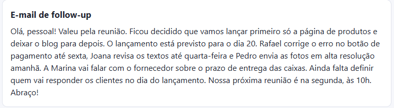

# 📝 Ata Pronta

**Transforma anotações bagunçadas (reunião, aula, assembleia, grupo de estudos) em um resumo claro, com decisões, tarefas (quem faz o quê e até quando) e um e-mail de follow-up pronto para enviar.**

## O problema

Toda reunião termina igual: muita conversa, e uma semana depois ninguém lembra o que foi decidido nem quem ficou de fazer o quê. Escrever a ata dá trabalho, então quase ninguém escreve. O Ata Pronta faz esse trabalho em segundos, em qualquer área: trabalho, faculdade, condomínio, associação, projeto pessoal.

## Como funciona

```
Suas anotações (.txt ou coladas na página)
        │
        ▼
 prompt.txt (instruções + regras)  ──►  IA (Claude ou Gemini)
        │                                   │
        │                                   ▼
        │                    resposta em JSON (formato fixo)
        ▼                                   │
 Conferência automática  ◄──────────────────┘
        │
        ▼
 Resumo · Decisões · Tarefas · Pontos em aberto · E-mail
```

O que torna a IA confiável aqui, e não só "um chat":

* **Prompt com regras claras** (`prompt.txt`): usar só o que está no texto, nunca inventar responsável ou prazo (escreve "não informado"), responder em formato fixo, com um exemplo.
* **Conferência da resposta**: se a IA devolver algo fora do formato, o programa pede de novo e corrige campos faltando.
* **Segurança**: o texto colado é tratado como dado, não como ordem (se alguém escrever "ignore as regras", a IA não obedece), e a página web escapa HTML.
* **Funciona sem chave de API** (modo demonstração) para qualquer pessoa testar.
* **Testes automáticos** (10) e **três exemplos de áreas diferentes** na pasta `exemplos/`.

## Como usar (resumo)

Precisa ter o Python 3.9+ instalado. Não precisa instalar mais nada.

```bash
python ata.py exemplos/reuniao_projeto.txt      # gera a ata e salva em resultados/
python ata.py minha_anotacao.txt --tom formal   # e-mail em tom formal
python web.py                                   # página web em http://127.0.0.1:8000
pip install -r requirements-dev.txt            # instala o pytest (só para os testes)
python -m pytest                                # roda os testes
```

**Primeira vez? Siga o** [**GUIA_INICIANTE.md**](GUIA_INICIANTE.md) (passo a passo, inclusive como conectar uma IA de verdade).

## Exemplo de resultado (modo demonstração)

Entrada: `exemplos/reuniao_projeto.txt`

|O quê|Quem|Prazo|
|-|-|-|
|corrigir o erro no botão de pagamento até sexta|Rafael|até sexta|
|revisar todos os textos das páginas até quarta-feira|Joana|até quarta-feira|
|enviar as fotos dos produtos em alta resolução amanhã|Pedro|amanhã|
|conversar com o fornecedor sobre o prazo de entrega das caixas|Marina|não informado|

> Ponto em aberto detectado: *"Ainda não sabemos quem vai responder os clientes no dia do lançamento."*



## Modos de funcionamento

|Modo|Como ativar|Qualidade|
|-|-|-|
|Demonstração|nenhuma chave configurada|Regras simples: acha frases como "Fulano vai fazer X até sexta". Bom para testar, limitado.|
|IA (Gemini ou Claude)|colocar a chave no arquivo `.env`|Entende frases livres, ironia e contexto, e escreve o e-mail de verdade.|

## Limitações (honestas)

* O modo demonstração não entende textos muito livres; para isso existe a IA.
* A integração com a IA real (Claude/Gemini) segue a documentação oficial dos provedores. O modo demonstração e os testes automáticos rodam sem chave.
* Com IA ligada, o texto é enviado ao provedor: não use com informações sensíveis.
* Não guarda histórico (só salva os arquivos em `resultados/`).

## Ideias para evoluir (ótimos exercícios com ajuda de IA)

1. Botão "copiar e-mail" na página web.
2. Ler anotações de arquivos `.docx` ou PDF.
3. Enviar o resultado para o Notion, Trello ou Google Sheets (via Zapier/Make).
4. Aceitar transcrição de áudio (por exemplo, a transcrição automática do Google Meet ou Zoom).

## Estrutura

```
ata.py            programa principal (linha de comando + lógica)
web.py            página web local
prompt.txt        instruções para a IA (edite para testar!)
exemplos/         3 exemplos de áreas diferentes
tests/            testes automáticos
GUIA_INICIANTE.md passo a passo para rodar
LICENSE           licença MIT
```

*Projeto construído com apoio de IA.*
